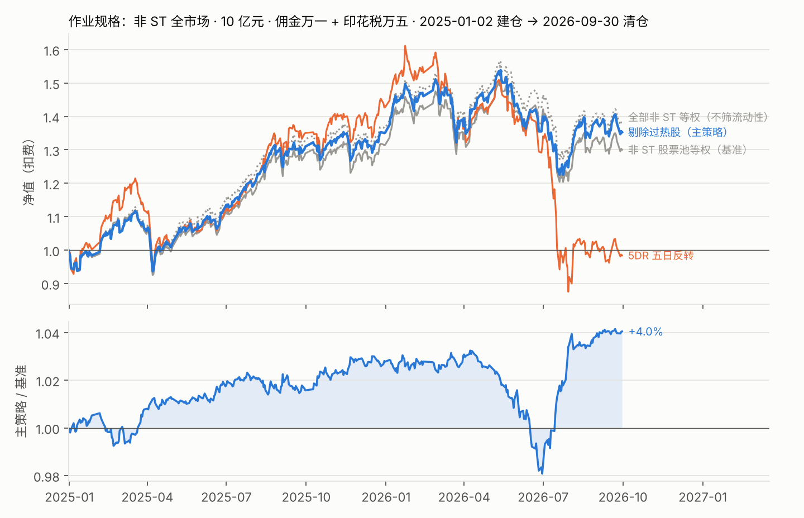
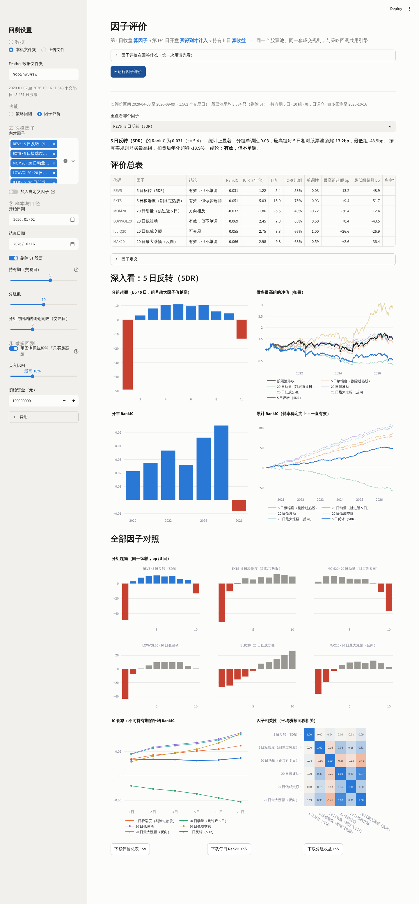
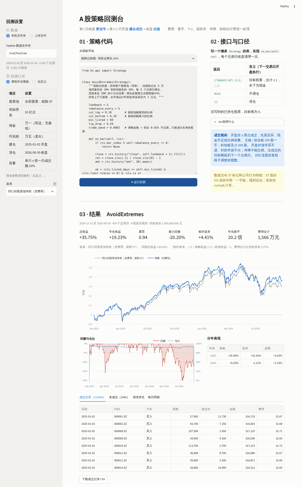
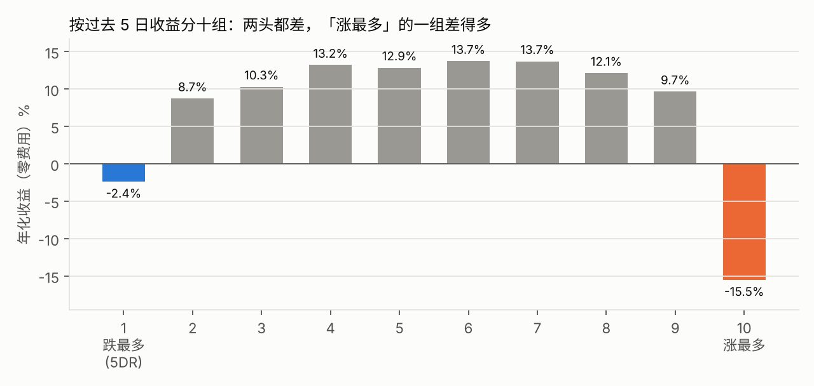

[Uploading README (1).md…]()
# A 股日频回测平台

「量化交易系统的原理」课程作业：**建立一个回测系统，并在其中验证策略。**

这是一个通用的 A 股日频回测环境：载入行情数据、选择区间和股票池、在网页上编写策略，点一下就得到扣费后的结果。
成交按 A 股真实规则处理（T+1、涨跌停、整手、停牌、除权、费用、成交额容量）。数据为课程提供的 2020-01-02 至 2026-10-16 全 A 股日频行情（5,451 只）。

本仓库包括五部分：

1. **作业**：按老师给定的规格（非 ST 全市场选股、10 亿元、万一佣金 + 万五印花税、2025-01 建仓至 2026-09 清仓）完成的回测
2. **因子评价**：在同一个平台上评价任意因子（IC、分组、衰减、换手、相关性、做多回测），以 5DR 为主做了完整评价
3. **平台**：网页界面 + 回测引擎，可以测试任意策略，内置「课程作业规格」一键口径
4. **可信度**：用单元测试和一个独立公式证明引擎算得对
5. **拓展研究**：5DR 全样本检验、剔除过热股的来源与留出检验、长鑫科技单股择时

> 仅用于课程学习与研究，不构成投资建议。

## 一、作业：非 ST 全市场选股

| 作业要求 | 实现 |
|---|---|
| ① 非 ST 股票上的全市场选股 | 全部 A 股中剔除 ST（数据无 ST 标记，按 ±5% 涨跌幅行为推断，见 [ST_INFERENCE.md](docs/ST_INFERENCE.md)），再剔除上市不满 60 日、流动性最差 20%、收盘一字板，约 4,000 只 |
| ② 初始资金 10 亿元 | 整手成交；单只股票当日成交 ≤ 前一交易日成交额的 10%（容量约束） |
| ③ 佣金单边万一；印花税万五 | 买卖各 0.01%（无最低佣金），卖出另加 0.05% |
| ④ 2025 年首个交易日建仓，2026 年 9 月最后一个交易日清仓 | 2024-12-31 收盘出信号 → **2025-01-02 开盘建仓** → 每 5 个交易日调仓 → **2026-09-30 收盘清仓** |

**主策略「剔除过热股」**：每 5 个交易日，按过去 5 日收益排序，剔除涨得最多的 10% 和跌得最多的 10%，其余约 3,200 只等权持有。
参数在 2020–2023 年选定后冻结，作业区间没有参与选参。



| 2025-01-02 → 2026-09-30（扣费后） | 剔除过热股（主策略） | 非 ST 股票池等权（基准） | 5DR 五日反转 |
|---|---:|---:|---:|
| 期末资金 | **13.53 亿元** | 13.00 亿元 | 9.84 亿元 |
| 总收益 | **+35.3%** | +30.0% | −1.6% |
| 年化收益 | 19.0% | 16.3% | −0.9% |
| 夏普 | 0.93 | 0.79 | 0.12 |
| 最大回撤 | −20.4% | −20.2% | −45.7% |
| 相对基准 | **+4.0%** | — | −24.3% |
| 年化换手 / 费用合计 | 19 倍 / 1,500 万元 | 3.7 倍 / 280 万元 | 87 倍 / 6,595 万元 |

**结论**：

- 主策略跑赢同口径基准 4.0%，夏普更高，回撤相同；成交额上限从 10% 收紧到 5% 结果不变，**10 亿元的容量不是问题**
- 但优势**不显著**：月度超额 t 值只有 0.6，超额主要来自 2026 年 7 月一个月（+5.5%）——那个月市场大跌，跌得最多的股票继续暴跌，主策略正好避开了它们。它的价值是「避开极端股票」，平时与等权组合相差不大
- **滑点是最大风险**：每加 5bp 滑点，超额少约 1.3 个百分点，超过约 15bp 超额就没有了
- 课程默认的 **5DR 在作业区间同样不成立**：总收益 −1.6%，2026 年 7 月一个月亏损 30%

完整说明、执行统计、月度超额与敏感性见 **[docs/ASSIGNMENT.md](docs/ASSIGNMENT.md)**。

## 二、因子评价

平台侧栏「功能」切换到**因子评价**，选因子（6 个内建，或自己写 `factor(d)` 函数）、样本区间、持有期、分组数，点「运行」即可得到完整的评价报告。
有两种方式：**单因子深度评价**（默认，只看 5DR，额外给出分样本、多空拆解、成本盈亏平衡、参数敏感性）和**多因子对照**。
评价与策略回测共用同一个股票池、同一套成交规则和同一个回测引擎。



| 问题 | 平台给出的指标与图表 |
|---|---|
| 有没有预测力 | RankIC、IC |
| 稳不稳 | ICIR、Newey-West t 值、IC > 0 比例、分年 RankIC、累计 RankIC 曲线 |
| 是不是单调 | 分组超额柱状图（重点因子 + 全部因子同一纵轴）、单调性 |
| 能不能赚钱 | 多空收益；**用回测引擎做多最高组**，扣费后对比同口径股票池等权 |
| 贵不贵 | 最高组每期换出比例、IC 衰减曲线（1–20 日） |
| 是不是重复 | 因子相关性热力图 |

**5DR 的评价结论**（2020-04 至 2026-09，非 ST）：RankIC 0.031、t 值 5.4，统计上显著；但十分组是倒 U 形，单调性只有 0.03——
预测力来自「涨得最多的会跌回来」（最低组每 5 天 −48.9bp），而 5DR 买入的「跌得最多」一组也跑输（−13.2bp），加上每期换掉 89% 的股票，
按真实规则做多年化跑输 13.9%。**IC 为正不等于买最高组能赚钱**。同一个信号改成「剔除两头」（5 日极端度），t 值 15.0、单调性 0.93，是六个因子里最稳的。

单因子深度评价进一步说明：5DR 在每个板块、每个流动性档、涨跌市里都显著（t 值 2.2–7.9），排名能力很稳；
但多空拆解显示最高组和最低组**都跑输**股票池，最高组扣费前就是 −13.2bp，所以不存在能让它赚钱的成本水平。
它真正擅长的是指出「哪些股票之后会跌得最狠」。

完整结果、指标定义、自定义因子写法与局限见 **[docs/FACTOR_EVAL.md](docs/FACTOR_EVAL.md)**。

## 三、平台

```bash
pip install -r requirements.txt
streamlit run app.py          # 浏览器打开 http://localhost:8501
```



截图为「课程作业规格」+「剔除过热股」模板的运行结果：+35.8%，相对同口径基准 +4.4%（与研究脚本的 +35.3% / +4.0% 规则相同，并列排名等细节略有差异）。

| 区域 | 功能 |
|---|---|
| 左侧 ① 数据 | 填 Feather 数据文件夹路径，或直接上传 7 个 `.feather` 文件 |
| 左侧 功能 | 切换「策略回测」与「因子评价」（因子评价见上一节） |
| 左侧 ② 回测口径 | **课程作业规格**（一键套用：非 ST 全市场、10 亿元、万一 + 万五、2025-01-02 建仓、2026-09-30 清仓、成交额上限 10%）或**自定义** |
| 自定义：股票池 | 全部股票 / 长鑫科技 / 34 只存储·半导体同类股 / 自定义代码；可选剔除 ST |
| 自定义：区间与资金 | 开始、结束日期（可选开始日开盘建仓、结束日收盘清仓），初始资金 |
| 自定义：交易规则 | 一键切换「A 股真实规则 / 理想化」；成交额上限；费用逐项可调，可设零费用 |
| 基准 | 同口径股票池等权（含费用）/ 股票池全部等权（零费用）/ 某只股票买入持有 |
| 01 策略代码 | 6 个模板（5DR、5 日动量、剔除过热股、趋势跟随、均线交叉、买入持有），可直接修改 |
| 03 结果 | 总收益、年化、夏普、最大回撤、相对基准、换手、费用；净值、回撤与仓位、分年表现；成交记录、未成交原因、期末持仓、每日明细（可下载 CSV） |

### 怎么写策略

只需要一个类，实现 `on_bar`，每个交易日收盘调用一次：

```python
from bt.api import Strategy

class MyStrategy(Strategy):
    def on_bar(self, ctx):
        close = ctx.history("close", 21)              # 最近 21 天，只到今天收盘（后复权价）
        ret = close.iloc[-1] / close.iloc[0] - 1
        return ctx.equal_weight(ret[ret > 0].index)   # 目标仓位 → 下一个交易日开盘成交
```

| 返回值 | 含义 |
|---|---|
| `{代码: 权重}` | 目标仓位，合计 ≤ 1（余下为现金），不能为负（A 股不能做空） |
| `None` | 不调仓 |
| `{}` | 清仓 |

`ctx` 还提供 `current`、`universe`、`is_st`、`listed_days`、`limit_status`、`positions`、`weights`、`cash`、`nav` 等，见平台右侧说明或 `bt/api.py`。

### 成交规则

| A 股规则 | 处理方式 |
|---|---|
| 不能用收盘价成交 | 第 t 日收盘出信号，第 t+1 日开盘成交（避免前视偏差） |
| T+1 | 每天只在开盘调仓一次，当天买入的最早次日卖出 |
| 费用 | 佣金 0.03%（最低 5 元）、过户费 0.001%、卖出印花税 0.1%（2023-08-28 起 0.05%）、滑点 5bp |
| 整手 | 主板 / 创业板 100 股；科创板至少 200 股，之后按 1 股递增 |
| 涨跌停 | 开盘封涨停买不进、封跌停卖不出；主板 10%、科创板 20%、创业板 2020-08-24 起 20%、新股前 5 天不限 |
| 停牌 | 不能交易，按最近收盘价估值；没成交的目标顺延到下一个交易日 |
| 分红送股 | 持股数按复权因子调整，与后复权价一致 |
| 成交额容量（可选） | 单只股票当日成交 ≤ 前一交易日成交额 × 上限比例，超出部分顺延 |
| ST（可选） | 剔除推断为 ST 的股票；已识别为 ST 的股票按 ±5% 判断封板 |
| 期末清仓（可选） | 最后一天收盘按收盘价卖出全部持仓 |

```text
7 张宽表 ──► bt/data.py       复权、停牌、涨跌停价、封板、上市天数
              │
策略 ───────► bt/api.py        每天收盘调用 on_bar，只给到当天为止的数据
              │                （研究脚本也可以用 bt/strategies.py 直接给出权重矩阵）
              ▼
           bt/engine.py      开盘撮合：费用、滑点、整手、T+1、涨跌停、停牌顺延、除权
              ▼
           bt/metrics.py     年化、夏普、回撤、换手、费用拖累、相对基准、分年
```

## 四、可信度：怎么证明它算得对

| 检查 | 结果 |
|---|---|
| 单元测试（合成数据） | 29 项全部通过：成交时点、费用与印花税切换、滑点、整手、涨跌停、停牌顺延、新股、除权、ST 推断、成交额上限、期末清仓、平台接口、因子评价统计与前视检查 |
| 与独立公式交叉验证 | 另写一个不经过引擎的向量化公式，在 2,367 只股票 × 1,643 个交易日上，零费用时两者逐日一致，**最大相对误差 4e-14** |
| 买入持有 | 净值之比 = 后复权价之比（含多次分红的浦发银行） |
| 不能看到未来 | 策略每天拿到的历史数据最后一天就是当天；平台逐日回调与研究脚本的矩阵方式结果完全一致 |
| 平台 = 研究脚本 | 在平台上用「趋势跟随」模板跑长鑫，结果与研究报告完全一致（−5.17%，4 笔成交）；平台基准与作业脚本基准完全一致（+30.03%） |

详见 [docs/ENGINE.md](docs/ENGINE.md)。

## 五、拓展研究

以下研究完成于老师补充作业规格之前，用的是当时的口径：2020–2026 全样本、佣金万三（最低 5 元）+ 过户费 + 印花税 + 5bp 滑点、股票池未剔除 ST。
「剔除过热股」就是在这里设计并选定参数的，之后原样用于作业。

| 案例 | 策略 | 结论 |
|---|---|---|
| **1. 5DR 全市场** | 每 5 日买入过去 5 日跌最多的 10% | **不成立**。扣费前年化 −2.3%，已跑输等权股票池（扣费前 7.6%）；扣费后 −11.6%，7 个年份全部跑输 |
| **2. 剔除过热股** | 持有整个股票池，剔除过去 5 日涨最多和跌最多的各 10% | **留出期成立**。2024-01 至 2026-10 扣费后 +32.6% vs 基准 +21.2%，年化超额 +3.3%，三个年份均为正 |
| **3. 长鑫科技择时** | 过去 20 日上涨则持有，否则空仓 | **收益没跑赢，回撤小一大半**。54 天收益 −5.2% vs 买入持有 −0.5%；最大回撤 −11% vs −29% |

### 案例 1：5DR 为什么不成立



按过去 5 日收益分十组，年化收益是**倒 U 形**：中间 8 组 8.7%~13.7%，跌最多的一组 −2.4%，涨最多的一组 −15.5%。
这段时间「涨多了会跌回来」很明显，「跌多了会涨回来」并不存在——5DR 买的恰好是没有效应的那一头。
再加上年换手 85 倍、费用每年吃掉 5.9%，扣费后亏损更大。

### 案例 2：剔除过热股（自己设计的策略）


**思路**：既然两头的股票之后都跑输中间，那就不去赌反弹，而是持有中间、避开两头。

**做法**：

1. 股票池：上市满 60 个交易日，剔除流动性最差的 20%，剔除当日收盘一字板
2. 每 5 个交易日，按过去 5 日收益排序，剔除涨幅最高 10% 与跌幅最大 10%，其余等权持有
3. 调仓容忍带 2bp：只交易进出名单的股票，不为价格漂移付 5 元最低佣金

**检验方法**：三个候选规则（剔除涨幅前 10% / 前 20% / 两头各 10%）只在 2020–2023 上比较，选出「两头各 10%」后冻结，
再在 2024-01 至 2026-10 上只跑一次。

| 留出期（扣费后） | 策略 | 基准（股票池等权） |
|---|---:|---:|
| 总收益 | **+32.6%** | +21.2% |
| 年化收益 | 10.8% | 7.3% |
| 夏普 | 0.53 | 0.40 |
| 最大回撤 | −27.5% | −27.1% |
| 年化换手 / 费用拖累 | 18 倍 / 1.0% | 2.9 倍 / 0.2% |

分年超额：2024 年 +5.9%、2025 年 +3.2%、2026 年（至 10-16）+0.1%。

**和 5DR 对比**：两者用的是**同一个信号**（过去 5 日收益）。5DR 集中买跌最多的 10%，换手 85 倍；这里持有中间 80%，换手 18 倍。
信号没变，用法变了，结论就从「不成立」变成「成立」。

**要打的折扣**：想法来自看过全样本的十分位图，留出期并非完全没被看过；超额集中在 2024–2025，2026 年基本打平；
回撤与基准相同，它是增强收益的组合，不是避险工具。

### 案例 3：长鑫科技（688825.SH）


长鑫存储的上市主体为长鑫科技，2026-07-27 在科创板上市，样本内只有 54 个交易日。在 54 天上挑参数必然过拟合，所以：

1. 在 34 只存储 / 半导体同类股的 2020–2025 历史上比较 L = 5 / 10 / 20，选出 L = 20 后冻结
2. 两个留出样本检验：同类股 2026 年；2020 年以来首日成交额最大的 20 只科创板新股上市后 54 天
3. 最后才用在长鑫上

结果：前 20 天没有信号，错过了上市初期从 49 元涨到 61.8 元的那段；10 月从 55 元跌到 45 元时已经空仓。
**收益 −5.2%，没跑赢买入持有的 −0.5%；最大回撤 −11%，买入持有为 −29%。**
类比样本是同样的规律：趋势规则在新股上的主要作用是躲开大跌，而不是多赚。


全部数字与解读见 [research/RESULTS.md](research/RESULTS.md)。

## 六、研究纪律

- **先写协议再看结果**：股票池、参数网格、选参标准、判定规则都写在 [research/PROTOCOL.md](research/PROTOCOL.md)，之后的改动记在修订记录里
- **选参和检验分开**：参数只在选参样本上选，冻结后在留出样本上只跑一次
- **扣费前后都报**：区分「信号本身不行」和「信号被成本吃掉」
- **说清楚想法从哪来**：剔除过热股是看过 5DR 十分位结果后才有的想法，报告里明确标注

## 七、复现

把课程数据的 7 个 `.feather` 文件放到 `raw/`，然后：

```bash
python -m pytest -q tests                 # 29 项单元测试，不需要行情数据
cd scripts
python run_assignment.py                  # 作业规格回测（约 15 秒）
python run_factor_eval.py                 # 因子评价（约 45 秒）
python validate_engine.py                 # 真实数据交叉验证
python run_5dr.py                         # 拓展研究 1
python diagnose_5dr.py                    # 拓展研究 1 的事后诊断
python run_overheat.py                    # 拓展研究 2
python run_cxmt.py                        # 拓展研究 3
python make_charts.py
```

每个脚本都在一分钟内跑完。删除 `outputs/` 后全部重跑，结果与仓库中的文件完全相同。

## 八、仓库结构

```text
.
├── README.md
├── app.py                   回测平台（Streamlit 网页）：策略回测
├── factor_page.py           回测平台：因子评价页
├── bt/                      回测系统
│   ├── data.py              行情读取与交易约束
│   ├── engine.py            撮合引擎 + 独立参照公式
│   ├── api.py               策略接口：Strategy / ctx，逐日回调
│   ├── factor_eval.py       因子评价：内建因子、IC / 分组 / 衰减 / 相关性 / 做多回测、前视检查
│   ├── templates.py         平台里的策略模板
│   ├── strategies.py        研究用策略（向量化，输出目标权重矩阵）
│   └── metrics.py           绩效指标
├── research/
│   ├── PROTOCOL.md          事前协议（含修订记录）
│   └── RESULTS.md           全部结果与解读
├── docs/
│   ├── ASSIGNMENT.md        作业正文：要求、实现、结果、敏感性
│   ├── FACTOR_EVAL.md       因子评价：方法、5DR 与对照因子结果、自定义因子
│   ├── ST_INFERENCE.md      ST 股票的推断规则与局限
│   ├── ENGINE.md            引擎设计与验证
│   ├── DATA_NOTES.md        数据口径核对
│   └── img/                 报告图
├── scripts/                 run_assignment.py 为作业脚本，其余为研究脚本；peers.py 为同类股名单
├── tests/                   单元测试（合成数据）
└── outputs/                 全部结果表
```

## 九、局限

- 只在开盘成交一次，未建模冲击成本（作业口径不加滑点，另做了 5bp / 10bp 敏感性）
- 数据没有 ST 标记，ST 是推断的：科创板和 2020-08-24 后创业板的 ST 识别不了，新被 ST 的股票会晚几天识别
- 剔除过热股的留出期并非完全干净（见上文）；长鑫只有 54 天、4 笔交易，只能作为案例
- 同类股名单按主营业务手工整理，不是行业分类数据
- 策略代码在本机执行，等同于运行自己写的 Python 脚本；平台不需要联网或任何账号
