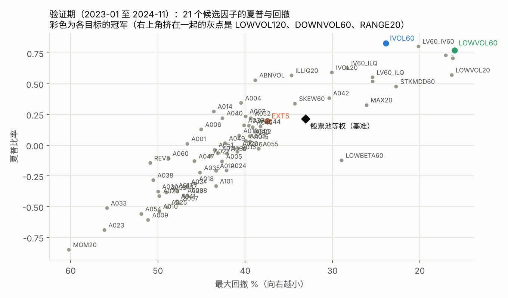
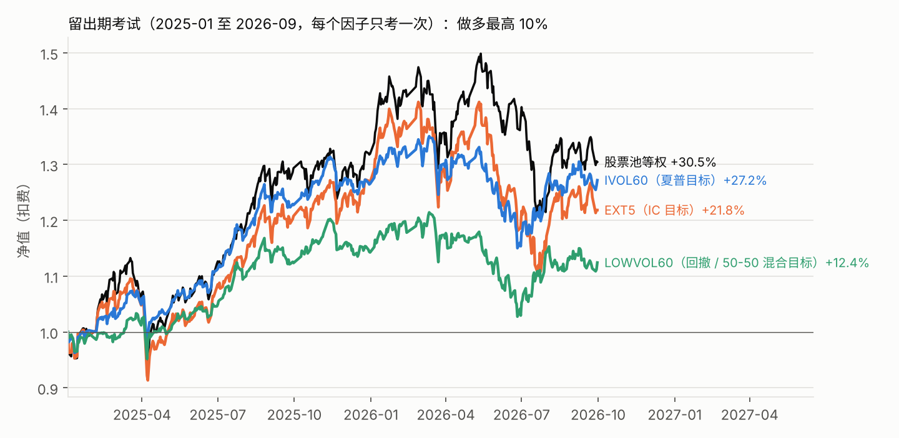
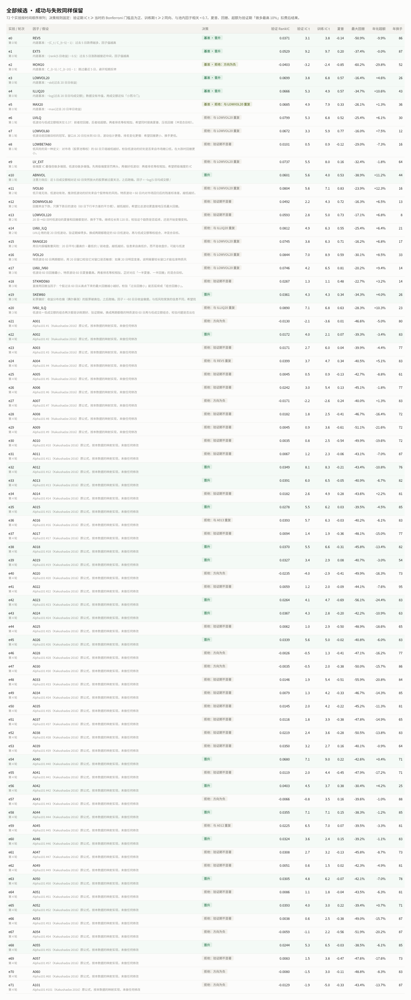
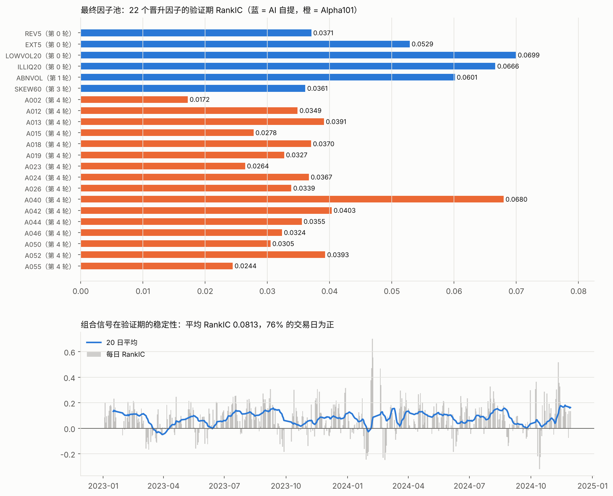

# 让 AI 自迭代的因子研究闭环：不同优化目标的比较（含 Alpha101）

回测系统和评价器（`bt/`）一行都没改。新增的 `research_loop/` 是套在外面的「研究循环」：AI 只负责提出因子，打分由固定的评价器完成，留出期上锁。
本次用同一份研究日志，比较四个优化目标：**IC、夏普、最大回撤、50% 夏普 + 50% 回撤**。

## 1. 闭环怎么运作

```text
① AI 读研究日志与排行榜 → 写反思（notes/roundN.md）→ 提出 3–5 个新因子（factors/*.py，每个附一句经济逻辑）
② run_round.py：前视检查 → 训练期、验证期各评价一次 → 与更早的因子算相关性 → 追加写入 ledger.jsonl（只增不改）
③ leaderboard.py：按四个目标分别排名，并给出多重检验校正后的显著门槛
④ 回到 ①；迭代结束后由人触发 final_exam.py：各目标冠军在留出期各考一次，不能重考
```

| 时段 | 区间 | 用途 |
|---|---|---|
| 训练期 | 2020-01 至 2022-11 | 探索，AI 看得到全部指标 |
| 验证期 | 2023-01 至 2024-11 | 按目标选冠军；与留出期之间空出约 1 个月，避免远期收益跨进留出期 |
| 留出期 | 2025-01 至 2026-09 | 最终考试，迭代中不可见（即上次作业的区间） |

评价口径与作业一致：非 ST 股票池、做多因子最高 10%、每 5 日调仓、1 亿元、佣金万一 + 印花税万五 + 滑点 5bp、单只成交额上限 10%。

| 目标 | 定义（验证期，越大越好） |
|---|---|
| IC | RankIC 的 Newey-West t 值 |
| 夏普 | 做多最高 10% 的扣费后夏普 |
| 最大回撤 | 做多最高 10% 的最大回撤（越接近 0 越好） |
| 50/50 混合 | 0.5 × z(夏普) + 0.5 × z(−最大回撤)，z 分数在全部候选里计算 |

研究守则见 `research_loop/PROGRAM.md`，每轮反思见 `research_loop/notes/`。

## 2. 迭代过程（4 轮，21 个因子）

| 轮次 | 提出的因子 | 关键发现（AI 的反思） |
|---|---|---|
| 0 | 6 个内建因子（基准） | 四个目标选出的冠军不同；低波动回撤最小，极端度 IC 最强但做多端弱 |
| 1 | 低波动 + 低成交额、低波动 60 日、低贝塔、低波动 + 极端度、成交额异常 | 低波动 60 日两期都好；**低贝塔失败** → 推测低波动的好处来自个股特有风险；成交额异常两期矛盾，不追 |
| 2 | 特质波动 60 日、下行波动、低波动 120 日、低波动 60 + 低成交额、日内振幅 | **推测被证实**：特质波动成为夏普冠军；窗口拉到 120 日反而变差；低成交额组合「训练期好、验证期掉」第二次出现 |
| 3 | 特质波动 20 日、低波动 + 特质波动、个股回撤、偏度、特质波动 + 低成交额 | 用「过去回撤」当因子无效；新因子与冠军相关多在 0.9 以上，判断已挖到尽头，停止迭代 |



验证期冠军：**IC → EXT5（t 9.2）；夏普 → IVOL60（0.83）；最大回撤 → LOWVOL60（−16.0%）；50/50 混合 → 同样是 LOWVOL60**。
试了 21 个因子，Bonferroni 校正后 IC 显著门槛从 1.96 提高到 3.04。

## 3. 留出期考试（每个冠军只考一次）



| 目标 | 冠军 | 验证期 夏普 / 回撤 | 留出期 IC t | 留出期夏普 | 留出期最大回撤 | 留出期总收益 | 年化超额 |
|---|---|---|---:|---:|---:|---:|---:|
| IC | EXT5 | 0.20 / −37.4% | **6.6** | 0.64 | −21.6% | +21.8% | −3.9% |
| 夏普 | IVOL60 | 0.83 / −23.9% | 2.8 | **1.00** | **−14.8%** | +27.2% | −2.6% |
| 回撤、50/50 混合 | LOWVOL60 | 0.77 / −16.0% | 1.9 | 0.56 | −15.4% | +12.4% | −9.9% |
| 基准 | 非 ST 股票池等权 | 0.22 / −33.1% | — | 0.83 | −19.4% | **+30.5%** | — |

## 4. 结论

1. **优化什么，就得到什么，而且只得到那个。** IC 冠军在留出期的 IC 依然最强（t 6.6），但做多不赚钱；夏普冠军拿到了最高的夏普（1.00 对 0.83），回撤也更小；回撤冠军压住了回撤（−15.4% 对 −19.4%），代价是收益只有基准的四成
2. **50/50 混合目标没有选出「折中」的因子，选中的就是回撤冠军。** 候选几乎都来自低风险家族，LOWVOL60 夏普排第 3、回撤排第 1，两项相加自然胜出。混合目标能否选出均衡的因子，取决于候选池本身是否多样
3. **在留出期，夏普目标最好：** 唯一一个夏普和回撤同时优于基准的冠军。按风险调整后的收益选因子，比只看 IC 或只看回撤更稳
4. **没有冠军跑赢基准的总收益。** 2025–2026 是强势上涨期，低风险因子在大涨时天然落后。验证期的超额（+7.5% 至 +12.3%）到了留出期都变成负值：市场环境变了，结论也跟着变
5. **验证期的分数是乐观的。** IVOL60 的 IC t 值从验证期 5.6 降到 2.8，低于校正门槛；LOWVOL60 从 3.3 降到 1.9。试得越多，挑出来的冠军越会高估自己
6. **AI 迭代的典型问题：很快收敛到一个家族。** 4 轮里 AI 一直在低风险方向上细化，新因子与冠军相关性越来越高。下一版应该把「与已有冠军的相关性」写进目标函数作为惩罚，逼它探索新方向

## 5. 第 4 轮：把 Alpha101 放进同一个闭环

前 3 轮 AI 自己提因子，很快收敛到「低风险」一个家族。第 4 轮改用 Alpha101（Kakushadze 2016, *101 Formulaic Alphas*）：
在本数据上实现了 51 个公式（`research_loop/alpha101.py`），**原样评价、不调参、不挑选**，全部写进日志。规则写于运行之前（`notes/round4_plan.md`）。

- 数据映射：成交股数 ≈ 成交额 / 典型价；VWAP ≈ 典型价 (H+L+C)/3；价格用后复权价
- 不实现：用到市值或行业中性化的 20 个（数据没有），以及部分带长小数参数的公式
- 公式根据论文附录转写，运算子有单元测试（`tests/test_alpha_ops.py`）；个别公式可能与原文有细微出入
- 新增第 5 个目标「新颖度」= 50/50 混合目标 − 与第 0–3 轮冠军的最大绝对相关

### 研究过程的全貌



72 个实验按时间顺序全部保留，被拒绝的写明原因。因子池的晋升规则固定：验证期 IC t ≥ 当时的 Bonferroni 门槛且为正、训练期 t ≥ 2 同向、与池内因子相关 < 0.7。


五个目标的冠军在第 3 轮之后都没有再变：**51 个 Alpha101 因子没有一个成为任何目标的冠军**，包括专门奖励新信号的「新颖度」目标。


按晋升规则，16 个 Alpha101 因子进池，池子从 6 个扩到 22 个；但等权组合的验证期 RankIC 从 0.093 **降到** 0.081，池内平均单因子 RankIC 从 0.054 降到 0.040。



### Alpha101 在各目标下的表现（验证期）

| | Alpha101 里最好的 | IC t | 夏普 | 最大回撤 | 年化超额 | 年换手 |
|---|---|---:|---:|---:|---:|---:|
| IC 目标 | A012 | 8.1 | −0.21 | −43.4% | −10.8% | 76 倍 |
| 夏普 / 回撤 / 混合 / 新颖度目标 | A042 | 4.5 | 0.38 | −30.4% | +4.2% | 25 倍 |
| 对比：本轮之前的冠军 | IVOL60 / LOWVOL60 | 5.6 / 3.3 | 0.83 / 0.77 | −23.9% / −16.0% | +12.3% / +7.5% | 16 / 12 倍 |

51 个里有 18 个 IC t 值超过校正门槛 3.39，但扣费后夏普高于基准（0.22）的只有 6 个。Alpha101 年换手中位数 81 倍，是前几轮因子的 3 倍：
**它们是为多空对冲、低成本设计的短线信号**，放进「只能做多、T+1、扣费」的规则里，优势基本被吃光。

### 留出期：追加考试

五个目标的冠军都已经考过，按守则不需要新考试。另外追加 4 项考试（事先写在 `notes/round4.md`，每个只考一次）：


| 考试对象 | 留出期 IC t | 夏普 | 最大回撤 | 总收益 | 年化超额 | 年换手 |
|---|---:|---:|---:|---:|---:|---:|
| **因子池 22 个等权（含 Alpha101）** | 7.4 | **1.21** | −24.8% | **+49.5%** | **+7.9%** | 72 倍 |
| 因子池 6 个等权（第 0–3 轮） | 6.1 | 1.00 | −22.6% | +37.1% | +2.7% | 50 倍 |
| A042（Alpha101 扣费后最好） | 2.8 | 0.90 | −22.4% | +32.5% | +0.7% | 25 倍 |
| A012（Alpha101 IC 最强） | 5.9 | 0.43 | −28.1% | +14.6% | −6.2% | 77 倍 |
| 对比：IVOL60（夏普冠军） | 2.8 | 1.00 | −14.8% | +27.2% | −2.6% | 15 倍 |
| 基准：非 ST 股票池等权 | — | 0.83 | −19.4% | +30.5% | — | — |

### 第 4 轮结论

1. **Alpha101 单个因子赢不了：** IC 最强的 A012 在留出期 IC 依然显著（t 5.9），收益却只有基准的一半——和 5DR 是同一个教训，IC 强不等于能赚钱
2. **但 22 个因子等权组合，是所有考试里唯一明显跑赢基准的：** 总收益 +49.5% 对 +30.5%，夏普 1.21 对 0.83。
   有意思的是，它在验证期和留出期的组合 IC 都**低于** 6 个因子的池子（0.081 对 0.093；0.076 对 0.082），按 IC 看「池子变大变差」，按钱看却变好了。
   许多低相关的短线信号叠在一起，让做多的最高组更稳定——**IC 和收益又一次指向不同的方向**
3. **代价是回撤和换手：** 最大回撤 −24.8%，比基准还深；年换手 72 倍，已计入 5bp 滑点，实盘冲击成本可能更高
4. **新颖度目标没起作用：** 惩罚项（0–1 的相关系数）比混合目标的分差小得多。在目标函数里加约束之前，要先把各项的单位对齐
5. **必须打折扣：** 组合规则（晋升门槛、等权）是看过前 3 轮结果后才定的；留出期只有 21 个月；一共考了 7 次，最好的那个也有运气成分

## 6. 局限（必须说明）

- **先验并不干净**：在上一讲的因子评价里，我（AI）已经看过内建因子在 2020–2026 全样本（含留出期）上的结果。新提出的因子在留出期是第一次评价，但「低风险方向有效」这个方向感可能部分来自那次经验
- 留出期只有约 21 个月，而且是单一的上涨行情；一次考试不足以下结论
- 21 个因子仍是小规模；IC 显著门槛按 Bonferroni 校正，实际上偏保守
- 未做市值、行业中性化；ST 为推断；留出期从 2025-01-02 收盘出信号，比作业晚一天建仓

## 7. 复现

```bash
cd research_loop
python run_round.py 0 builtin:REV5 builtin:EXT5 builtin:MOM20 builtin:LOWVOL20 builtin:ILLIQ20 builtin:MAX20
python run_round.py 1 factors/LVILQ.py factors/LOWVOL60.py factors/LOWBETA60.py factors/LV_EXT.py factors/ABNVOL.py
python run_round.py 2 factors/IVOL60.py factors/DOWNVOL60.py factors/LOWVOL120.py factors/LV60_ILQ.py factors/RANGE20.py
python run_round.py 3 factors/IVOL20.py factors/LV60_IV60.py factors/STKMDD60.py factors/SKEW60.py factors/IV60_ILQ.py
python leaderboard.py
python final_exam.py EXT5 IVOL60 LOWVOL60 --why "各目标的验证期冠军"   # 只能运行一次
python make_report_charts.py

# 第 4 轮：Alpha101
python backfill_cache.py                       # 为旧因子补算相关性缓存
./run_alpha_batches.sh                          # 51 个公式分批评价，约 30 分钟
python make_loop_charts.py                      # 候选表数据、冠军轨迹、因子池效用、最终因子池
python render_table.py                          # 全部候选表图片
python exam_pool.py                             # 因子池组合的留出期考试（只能运行一次）
python final_exam.py A012 A042 --why "追加考试"   # 只能运行一次
python make_report_charts.py
```

每轮约 2–3 分钟。`ledger.jsonl`、`exams.jsonl`、`notes/` 保存了完整的过程记录。
