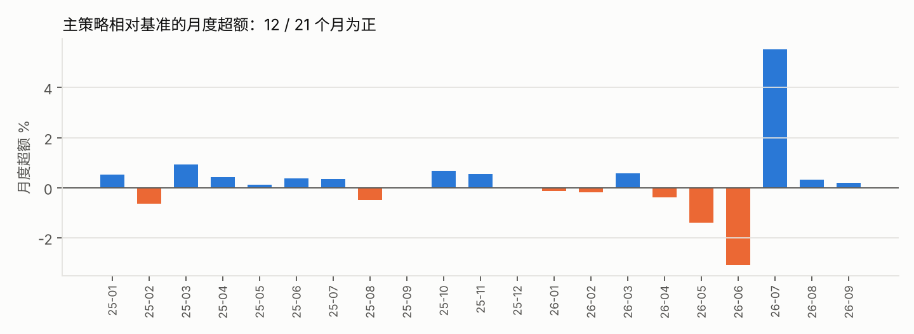

# 作业：非 ST 全市场选股回测（10 亿元，2025-01 至 2026-09）

## 1. 作业要求与实现

| 要求 | 实现方式 | 代码 |
|---|---|---|
| ① 在非 ST 股票上做全市场选股 | 全部 A 股（数据里 5,451 只），每个信号日剔除推断为 ST 的股票，再剔除上市不满 60 日、20 日均成交额最低 20%、当日收盘一字板的股票，剩下约 4,000 只构成股票池。已持有的股票一旦被识别为 ST，下一次调仓时卖出 | `bt/data.py`（ST 推断）、`bt/strategies.py::universe` |
| ② 初始资金 10 亿元 | `capital = 1e9`；成交按整手（主板 / 创业板 100 股，科创板 ≥ 200 股），现金不足时按比例缩减 | `scripts/run_assignment.py` |
| ③ 佣金单边万一；印花税万五 | 买卖各收 0.01% 佣金（不设最低 5 元），卖出另收 0.05% 印花税；不加过户费。主结果不加滑点，另做 5bp / 10bp 敏感性 | `spec_costs()` |
| ④ 2025 年第一个交易日建仓，2026 年 9 月最后一个交易日清仓 | 2024-12-31 收盘出信号 → **2025-01-02 开盘建仓**；之后每 5 个交易日调仓；**2026-09-30 收盘按收盘价全部卖出**。共 424 个交易日 | `liquidate_at_end=True` |

数据没有 ST 标记，ST 是按「涨跌幅被限制在 ±5%」的价格行为推断的，规则和局限见 [ST_INFERENCE.md](ST_INFERENCE.md)。

**额外考虑：10 亿元的容量。** 10 亿元分到几千只股票，单只约 30 万元，对大多数股票无压力；但对冷门股，一次买入可能占当天成交额的很大比例。
所以规定：**单只股票当天成交金额不超过它前一个交易日成交额的 10%**，超出部分顺延到下一个交易日。用前一日而不是当日的成交额，是因为开盘时还不知道当天会成交多少。

## 2. 策略

### 主策略：剔除过热股

每 5 个交易日：

1. 计算股票池里每只股票过去 5 日的收益（后复权价）
2. 剔除涨幅最高的 10% 和跌幅最大的 10%
3. 其余约 3,200 只**等权**持有；单只调整金额小于组合 0.02% 时不交易（只调整进出名单的股票）

**为什么选它**：在 2020–2026 全样本上，按过去 5 日收益分十组，两头的股票之后都明显跑输中间（见 [RESULTS.md §1](../research/RESULTS.md)）。
这个规则的参数是在 **2020–2023 年**选定的（三个候选里扣费后超额最高），之后没有再改。作业区间 2025-01 至 2026-09 没有参与选参。
但要说明：这段时间落在之前「2024–2026 留出期」里，留出期的结果已经被看过，所以它不是完全新鲜的样本。

### 对照

| 组合 | 说明 |
|---|---|
| 非 ST 股票池等权（**基准**） | 同一个股票池全部等权，同样每 5 日调仓、同样费用和容量限制 |
| 5DR 五日反转 | 课程默认策略：买入过去 5 日跌得最多的 10% |
| 全部非 ST 等权（不筛流动性） | 不做上市天数和流动性筛选，只剔除 ST，用来看「流动性筛选」本身的影响 |

## 3. 结果


| 2025-01-02 → 2026-09-30（扣费后） | 剔除过热股（主策略） | 非 ST 股票池等权（基准） | 5DR 五日反转 | 全部非 ST 等权（不筛流动性） |
|---|---:|---:|---:|---:|
| 期末资金 | **13.53 亿元** | 13.00 亿元 | 9.84 亿元 | 13.79 亿元 |
| 总收益 | **+35.3%** | +30.0% | −1.6% | +37.9% |
| 年化收益 | 19.0% | 16.3% | −0.9% | 20.3% |
| 年化波动 | 21.3% | 22.2% | 30.0% | 20.9% |
| 夏普 | 0.93 | 0.79 | 0.12 | 0.99 |
| 最大回撤 | −20.4% | −20.2% | −45.7% | −18.7% |
| 相对基准（总） | **+4.0%** | — | −24.3% | — |
| 信息比率 | 0.77 | — | −1.00 | — |
| 年化换手 | 19.4 倍 | 3.7 倍 | 87.2 倍 | 1.4 倍 |
| 费用合计 | 1,500 万元 | 280 万元 | 6,595 万元 | 114 万元 |
| 平均持股数 | 3,232 | 4,040 | 405 | 5,080 |
| 成交笔数 | 108,743 | 27,086 | 62,974 | 13,372 |

分年：

| | 主策略 | 基准 | 超额 |
|---|---:|---:|---:|
| 2025 年 | +35.2% | +31.5% | +2.8% |
| 2026 年 1–9 月 | +0.1% | −1.1% | +1.2% |

### 月度超额：12 / 21 个月为正



### 交易执行情况（主策略）

| 事件 | 次数 | 怎么处理 |
|---|---:|---|
| 停牌，无法交易 | 2,426 | 目标顺延，复牌后执行 |
| 开盘跌停，卖不出 | 390 | 顺延到下一个交易日 |
| 超过成交额上限，部分成交 | 254 | 超出部分顺延 |
| 开盘涨停，买不进 | 74 | 顺延到下一个交易日 |
| 清仓日停牌 / 收盘跌停，卖不出 | 11 只 | 按收盘价计入期末市值，占期末资金约 0.3% |

建仓当天（2025-01-02）买入约 3,190 只股票，佣金约 10 万元。

## 4. 敏感性：结论稳不稳

| 情形 | 主策略总收益 | 基准总收益 | 相对基准 |
|---|---:|---:|---:|
| 作业口径（无滑点，成交额上限 10%） | 35.3% | 30.0% | +4.0% |
| 加滑点 5bp | 33.1% | 29.5% | +2.7% |
| 加滑点 10bp | 30.9% | 29.2% | +1.3% |
| 成交额上限收紧到 5% | 35.3% | 30.0% | +4.0% |
| 不设成交额上限 | 35.2% | 30.0% | +4.0% |
| 不剔除 ST | 35.6% | 30.0% | +4.3% |
| 股票池不做流动性筛选（基准同口径） | 43.7% | 37.9% | +4.2% |

- **容量不是问题**：成交额上限从 10% 收紧到 5%，结果几乎不变
- **滑点是最大的敏感项**：主策略换手 19 倍，每 5bp 滑点吃掉约 1.3 个百分点的超额；滑点超过约 15bp，超额就没有了
- **换一个股票池，超额仍在 +4% 左右**：不做流动性筛选时，基准本身更高（小盘股 2025 年涨得多），但剔除两头的规则同样多赚约 4%

## 5. 结论

1. **主策略跑赢了基准，但优势不大，统计上也不显著。** 424 个交易日扣费后多赚 4.0%，夏普 0.93 对 0.79，回撤相同。
   月度超额的 t 值只有 0.6；而且超额主要来自 **2026 年 7 月**一个月（+5.5%）。那个月股票池下跌 12%，跌得最多的股票继续暴跌，
   5DR 一个月亏了 30%，而主策略正好避开了这些股票。去掉这个月，其余 20 个月合计超额约 −1.4%
2. **它的价值在于「避开极端股票」**：平时和等权组合差不多，市场剧烈下跌、个股走向极端时才拉开差距。这和之前研究的结论一致
3. **5DR 在作业区间同样不成立**：总收益 −1.6%，跑输基准 24%，最大回撤 −46%，费用 6,600 万元。2026 年 7 月「跌得多的继续跌」是它最大的一次失败
4. **成本和执行**：佣金万一很低，主策略的费用拖累每年只有 0.7%；但它对滑点敏感，实盘时开盘集合竞价的冲击需要认真估计

## 6. 复现

```bash
cd scripts
python run_assignment.py      # 约 15 秒；结果写到 outputs/assignment/
python make_charts.py
```

也可以在网页平台里选「课程作业规格」，用「剔除过热股」模板直接运行。
平台版本实现的是同一规则，但并列排名、流动性分位等细节略有差异：平台结果为总收益 +35.8%（研究脚本 +35.3%）。
平台默认基准「同口径股票池等权（含费用）」与这里的基准完全相同（+30.0%），所以平台显示的相对基准为 +4.4%。

| 输出文件 | 内容 |
|---|---|
| `summary.csv` | 四个组合的全部指标 |
| `monthly.csv` / `nav.csv` | 月度收益、每日净值 |
| `sensitivity.csv` | 敏感性 |
| `trades_*.csv.gz` / `rejects_*.csv` / `daily_*.csv` | 逐笔成交、未成交记录、每日明细 |
| `universe_counts.csv` / `st_inferred_symbols.csv` | 每日 ST 数量与股票池大小、区间内识别出的 ST 名单 |
