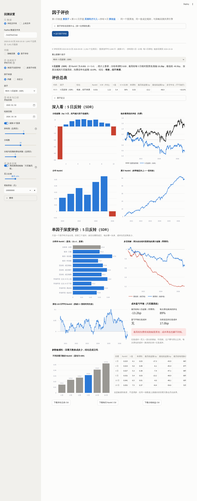

# 因子评价

因子是每个交易日给每只股票打的一个分数。评价因子，就是用历史数据检查这个分数：能不能预测未来收益、稳不稳、能不能真的赚到钱。
本仓库把因子评价做进了回测平台（侧栏「功能 → 因子评价」），并与策略回测共用同一个股票池、同一套成交规则和同一个回测引擎。


## 1. 评价回答的六个问题

| 问题 | 指标 | 怎么读 |
|---|---|---|
| 有没有预测力 | IC、**RankIC** | 每天算「今天的因子排名」与「之后 h 天收益排名」的相关系数，再取平均。> 0 说明分数高的股票之后涨得多 |
| 稳不稳 | ICIR、Newey-West t 值、IC > 0 的比例、分年 RankIC、累计 RankIC | \|t\| ≥ 2 视为显著；累计 RankIC 斜率稳定向上 = 一直有效 |
| 是不是单调 | 分组超额收益、单调性 | 按因子分 10 组，各组相对股票池平均的超额；单调性 = 各组超额与组号的秩相关，1 为完全单调 |
| 能不能赚钱 | 多空收益、**做多回测** | A 股基本不能做空，所以关键是「只买最高组」在回测引擎里扣费后能否跑赢同口径股票池等权 |
| 贵不贵 | 最高组每期换出比例、因子自相关、IC 衰减 | 换出越多费用越高；IC 随持有期怎么变决定多久调一次仓 |
| 是不是重复 | 因子相关性 | 平均横截面秩相关；高度相关的两个因子只需要一个 |

结论标签按以下顺序判断：\|t\| < 2 → 无预测力；RankIC < 0 → 方向相反；做多年化超额 > 2% 且信息比率 > 0.5 → 可交易；单调性 > 0.8 → 有效，但做多端弱；其余 → 有效，但不单调。

## 2. 口径

- **股票池**：剔除推断的 ST、上市不满 60 日、20 日均成交额最低 20%、当日收盘一字板
- **远期收益**：第 t 日收盘出信号 → 第 t+1 日开盘买入 → 持有 h 日到开盘卖出（后复权）。第 t+1 日开盘停牌或封涨停的股票不参与当天评价，只评价真能买到的股票
- **分组**：每 5 个交易日一次（不重叠），10 组
- **做多回测**：因子最高 10% 等权，每 5 日调仓，1 亿元，佣金万一 + 印花税万五 + 滑点 5bp，单只成交 ≤ 前一日成交额 10%
- **前视检查**（自定义因子）：把数据截断在某一天后重算因子，若那一天的因子值和用全量数据算的不同，说明用到了未来数据，平台拒绝评价

以上参数在平台侧栏都可以改。

## 3. 结果：5DR 与五个对照因子（2020-04 至 2026-09，非 ST）

| 因子 | 结论 | RankIC | t 值 | 单调性 | 最高组超额（bp/5 日） | 最低组超额 | 最高组每期换出 | 做多年化超额 |
|---|---|---:|---:|---:|---:|---:|---:|---:|
| **5 日反转（5DR）** | 有效，但不单调 | 0.031 | 5.4 | 0.03 | −13.2 | −48.9 | 89% | **−13.9%** |
| 5 日极端度（剔除过热股） | 有效，但做多端弱 | 0.051 | 15.0 | 0.93 | +9.4 | −51.7 | 89% | −1.3% |
| 20 日动量（跳过近 5 日） | 方向相反 | −0.037 | −5.5 | −0.72 | −36.4 | +2.4 | 51% | −20.9% |
| 20 日低波动 | 有效，但不单调 | 0.069 | 7.8 | 0.50 | +0.4 | −43.5 | 26% | −0.1% |
| 20 日低成交额 | 可交易 | 0.055 | 8.3 | 1.00 | +26.6 | −26.9 | 43% | **+10.7%** |
| 20 日最大涨幅（反向） | 有效，但不单调 | 0.066 | 9.8 | 0.59 | +2.6 | −36.4 | 36% | −0.1% |

**读法：**

1. **5DR 有预测力，但不能直接拿来做多。** RankIC 显著为正，十分组却是倒 U 形：涨得最多的一组每 5 天跑输 49bp，跌得最多的一组（5DR 买的）也跑输 13bp。
   IC 只说明「整体排名对不对」，不说明「买最高那组能不能赚钱」。再加上每期要换掉 89% 的股票，扣费后做多年化跑输 13.9%
2. **同一个信号换个用法就最稳。** 5 日极端度把两头都当成坏股票，ICIR 5.0、t 值 15.0、单调性 0.93，是六个因子里最稳定的；它的价值在于剔除最差的两头，这正是作业主策略「剔除过热股」的来源
3. **扣费后只有低成交额因子明显跑赢**（年化超额 +10.7%，十组完全单调），但它本质是小盘效应，容量和风格风险要另外评估
4. **20 日动量在 A 股方向相反**；低波动与最大涨幅相关 0.87，基本是同一个信号
5. 5DR 在 2026 年（截至 9 月）RankIC 为负，是唯一一年失效

## 4. 只评价 5DR：单因子深度评价

平台侧栏选「单因子深度评价」并选 5DR（默认就是），除了上面的指标外，会再回答三个追问：效应在哪里成立、钱从哪一头来、成本扣完还剩多少。



**① 效应在哪里成立：分样本 RankIC**

| 样本 | RankIC | t 值 |
|---|---:|---:|
| 全样本 | 0.031 | 5.4 |
| 主板 / 创业板 / 科创板 | 0.030 / 0.045 / 0.029 | 5.3 / 7.9 / 4.7 |
| 成交额低 / 中 / 高 | 0.034 / 0.039 / 0.032 | 5.8 / 6.6 / 5.2 |
| 过去 20 日市场上涨 / 下跌 | 0.039 / 0.021 | 6.0 / 2.2 |
| 高波动 / 低波动市场 | 0.035 / 0.027 | 3.9 / 3.8 |

每个子样本都显著，说明 5DR 的排名能力不是某个板块或某类股票造成的；创业板最强，市场下跌时最弱。
滚动 120 日 RankIC 大部分时间在 0 以上，几次短暂跌破 0，最深的一次在 2026 年。

**② 钱从哪一头来：多空拆解**

把最高组（5DR 买入的「跌最多」）和最低组（「涨最多」）相对股票池的超额分别累计：最低组一路跌到 0.20，最高组也跌到 0.63。
**两头都跑输股票池**，只是最低组跑输得多得多。RankIC 为正，是因为「涨最多的跌得更狠」，而不是「跌最多的会反弹」。

**③ 成本扣完还剩多少：盈亏平衡**

| | 数值 |
|---|---:|
| 最高组每 5 日超额（零费用） | −13.2bp |
| 每次调仓换掉的持仓 | 89% |
| 盈亏平衡往返成本 | 无（扣费前就跑输） |
| 作业口径往返成本（佣金万一 ×2 + 印花税万五 + 滑点 5bp ×2） | 17.0bp |

对比：5 日极端度的最高组每 5 日超额 +9.4bp、换手 89%，盈亏平衡往返成本约 10.6bp，也低于 17.0bp——所以它适合当「剔除」用，而不是集中买最高组。

**④ 参数敏感性：回看天数**

| 回看 | 1 日 | 2 日 | 3 日 | **5 日** | 10 日 | 20 日 |
|---|---:|---:|---:|---:|---:|---:|
| RankIC | 0.015 | 0.023 | 0.027 | **0.031** | 0.041 | 0.052 |
| 最高组超额（bp/5 日） | −17.3 | −6.1 | −7.4 | **−13.2** | −4.0 | +8.4 |
| 最高组每期换出 | 86% | 87% | 88% | **89%** | 69% | 53% |

所有回看天数的 RankIC 都显著为正，结论「反转有预测力」不依赖 5 日这个参数；但「做多最高组跑输」在 1–10 日都成立。
回看拉长到 20 日后最高组转正、换手下降。这只是敏感性检查：在同一份数据上挑最好的回看天数会高估效果，要用就得像作业主策略那样先在一段样本上选、再到另一段样本上检验。

**一句话结论**：5DR 是一个**稳定但用错了方向的好信号**——它真正擅长的是指出「哪些股票之后会跌得最狠」，而 A 股不能做空，集中买它的最高组又付不起换手成本。

## 5. 自定义因子

在平台打开「加入自定义因子」，写一个 `factor(d)` 函数，返回「交易日 × 股票」的数组，值越大表示预期收益越高：

```python
def factor(d):
    C = ffill(np.where(d.traded, d.adj_close, np.nan))
    hi = pd.DataFrame(C).rolling(20, min_periods=16).max().to_numpy()
    lo = pd.DataFrame(C).rolling(20, min_periods=16).min().to_numpy()
    return -(C - lo) / (hi - lo)          # 20 日价格位置，越低越好
```

可用的工具函数：`past_return(d, n)`、`daily_return(d)`、`roll_mean`、`roll_std`、`roll_max`、`ffill`、`np`、`pd`。

## 6. 正确性

- 单元测试 6 项（`tests/test_factor_eval.py`）：相关系数与 numpy 一致、横截面排名、Newey-West t 值、前视检查能抓到用未来数据的因子、「作弊因子」（直接用未来收益）RankIC > 0.99 且完全单调、随机因子 RankIC ≈ 0
- 与一份独立写的评价脚本（逐日循环 + scipy）逐项对比：RankIC、ICIR、t 值、分组超额、换手、做多回测超额全部一致
- 某一天的 5DR RankIC 用 `scipy.stats.spearmanr` 独立重算，结果相同

## 7. 局限

- 数据没有市值、行业，未做市值和行业中性化；低成交额因子用成交额近似规模
- ST 为推断（见 [ST_INFERENCE.md](ST_INFERENCE.md)）
- 每个因子只试了一组定义和参数，没有为提高 IC 调参；在同一份数据上反复挑因子会高估效果

复现：`cd scripts && python run_factor_eval.py`（约 45 秒，结果在 `outputs/factors/`）。
