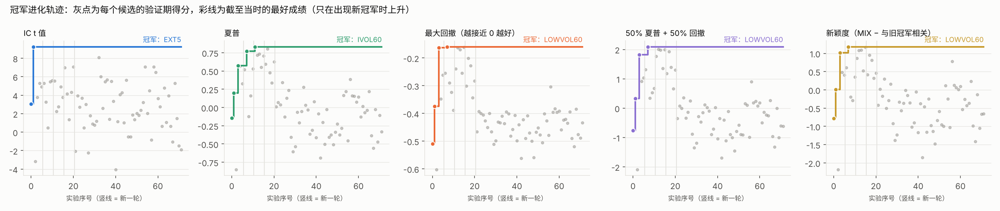
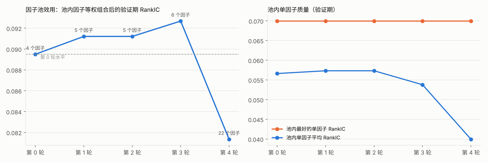
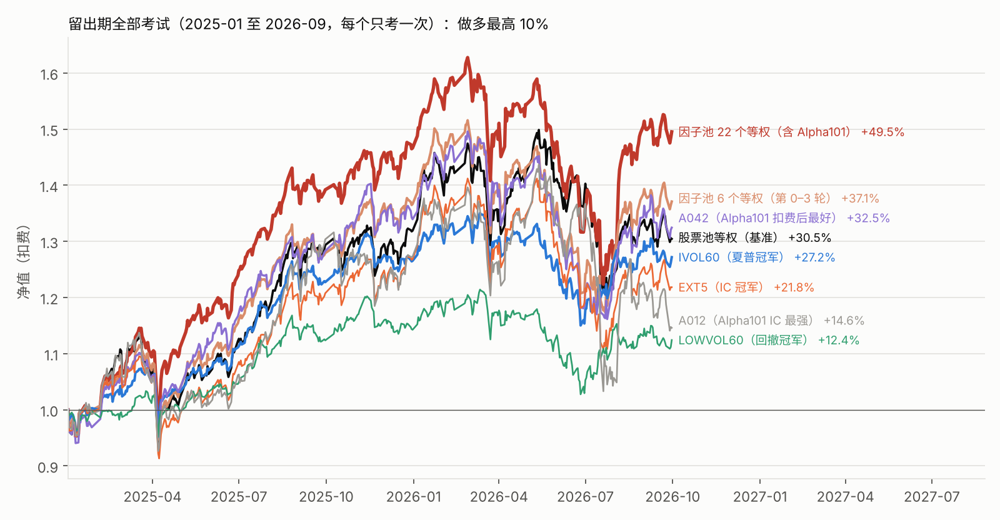

# 优化目标设定的演进与研究结论

本文记录 AI 自迭代因子研究中优化目标的演进过程：各阶段的设定依据、样本外表现及由此得出的方法论结论。
数据均来自 `research_loop/` 的研究日志与留出期检验，完整过程见 [AI_LOOP.md](AI_LOOP.md)。

## 1. 以信息系数为目标：预测力与可实现收益的背离

初始阶段沿用常规做法，以 RankIC 衡量因子有效性。5DR 的 RankIC 为 0.031（Newey-West t = 5.4），统计上显著；
但在扣费、T+1 与整手约束下做多最高十分位，年化超额为 −13.9%。多空分解显示，其预测力集中于空头端（前期涨幅最大组的后续收益显著为负），
在无法做空的 A 股环境中不可实现。

**结论 1**：IC 度量的是横截面排序的整体相关性，不等价于多头组合的可实现收益。在不可做空且存在交易成本的约束下，
以 IC 为唯一目标会系统性地选出高换手、收益集中于空头端的因子。

## 2. 引入风险调整收益与回撤目标

据此将目标函数改为多头组合（最高 10%）的扣费后夏普比率与最大回撤，均在 T+1、涨跌停、整手与成交额容量约束下计算。
同一研究日志在不同目标下的最优因子明显分化：IC 目标选出 EXT5，夏普目标选出 IVOL60（60 日特质波动率），回撤目标选出 LOWVOL60（60 日总波动率）。

留出期（2025-01 至 2026-09，迭代期间不可见）检验结果与各自目标高度一致：

| 目标 | 最优因子 | 样本外改善的维度 | 样本外的代价 |
|---|---|---|---|
| IC | EXT5 | RankIC 保持显著（t = 6.6） | 夏普 0.64，低于基准 0.83 |
| 夏普 | IVOL60 | 夏普 1.00、最大回撤 −14.8%，均优于基准 | 绝对收益略低于基准 |
| 最大回撤 | LOWVOL60 | 最大回撤 −15.4%，优于基准 | 收益仅为基准的约四成 |

**结论 2**：目标函数决定了优化结果的性质，系统只会改善被显式纳入目标的维度；收益、换手、容量等未纳入的维度不会自动得到约束。

## 3. 复合目标：候选集同质化导致退化

为在风险调整收益与回撤控制之间取得平衡，构造复合目标：0.5 × z(夏普) + 0.5 × z(−最大回撤)，z 分数在全部候选中计算。
其最优解与回撤目标相同（LOWVOL60）：候选因子高度集中于低风险类，LOWVOL60 在夏普维度排名第三、回撤维度排名第一，复合得分自然最高。

**结论 3**：复合目标能否识别出均衡的因子，取决于候选集在各维度上的分散程度。候选集同质化时，权重设定对最优解几乎没有影响。

## 4. 搜索收敛与新颖度约束

研究日志显示，AI 的提案在四轮内持续收敛于低风险因子族（总波动率 → 特质波动率 → 下行波动率 → 日内振幅），
第 3 轮新提案与既有最优因子的秩相关多在 0.9 以上，搜索陷入局部最优。为此采取两项措施：
引入 Alpha101 的 51 个公式作为外部候选，并新增新颖度目标（复合目标减去与既有最优因子的最大绝对秩相关）。

新颖度目标同样未选出新因子。惩罚项取值在 [0, 1]，而复合目标的得分跨度达数个标准差，惩罚项的边际影响不足以改变排序。

**结论 4**：在目标函数中加入约束或惩罚项之前，须先对各项进行量纲统一；否则约束在形式上存在，实际上不改变优化结果。

## 5. 单因子与合成因子的表现分化

Alpha101 单因子的预测力较强：51 个公式中 18 个的验证期 IC 通过 Bonferroni 校正（最高 t = 8.1），
但年化换手中位数达 81 倍，在仅做多、扣费的设定下，无一在任何目标下成为最优因子。

按固定的入池规则（验证期 IC 显著、训练期同向、与池内因子相关性低于 0.7），16 个 Alpha101 因子入池，因子池由 6 个扩至 22 个。
等权合成信号的验证期 RankIC 由 0.093 降至 0.081，单从 IC 看，扩池并未带来增益。

留出期检验给出了相反的结论：22 因子等权合成组合总收益 +49.5%、夏普 1.21，是全部检验中唯一显著跑赢基准（+30.5%、0.83）的组合；
6 因子组合为 +37.1%、夏普 1.00。

**结论 5**：合成因子的 IC 与多头组合收益并不单调对应。多个低相关的弱信号等权合成后，多头组合的选股稳定性提高，
这一增益无法从合成后的 IC 中直接观察到。IC 与可实现收益的背离在研究中多次出现，是本项目最主要的实证发现。

## 6. 过拟合与选择偏差的控制

研究过程中设置了以下控制措施，且均观察到实际作用：

- **留出期锁定、单次检验**：最优因子的 IC t 值在样本外普遍下降（IVOL60 由 5.6 降至 2.8，EXT5 由 9.2 降至 6.6），验证期表现存在明显的乐观偏差
- **多重检验校正**：72 个实验后，Bonferroni 校正将 IC 显著性门槛由 1.96 提高至 3.39
- **完整记录失败实验**：72 个实验中 50 个被拒绝，均记录原因；正是这些记录揭示了搜索的路径依赖
- **如实披露信息泄露**：评估内建因子时曾观察全样本（含留出期）结果；入池规则在前三轮之后确定；留出期共进行 7 次检验，最优结果存在选择偏差

**结论 6**：自迭代因子挖掘的主要风险不在于搜索效率不足，而在于样本内过拟合与选择偏差。闭环设计中，防止数据窥探的机制与搜索机制同等重要。

## 7. 后续改进方向

1. 对各目标分量先做量纲统一，再构造复合目标与惩罚项
2. 将与既有最优因子的相关性设为硬约束，强制搜索偏离已覆盖的因子族
3. 以滚动的多段样本外检验替代单一留出期，降低单次检验的偶然性
4. 将换手与容量直接纳入目标函数，而非仅在回测中扣除成本
