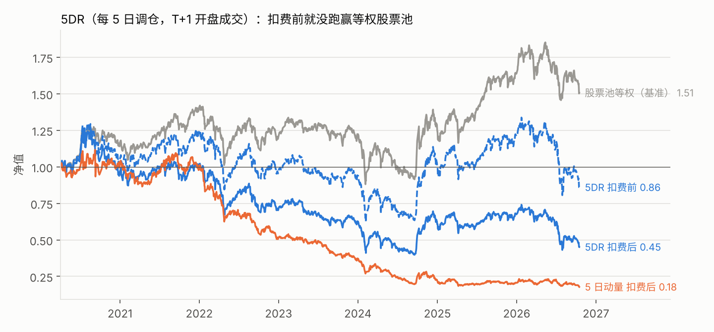
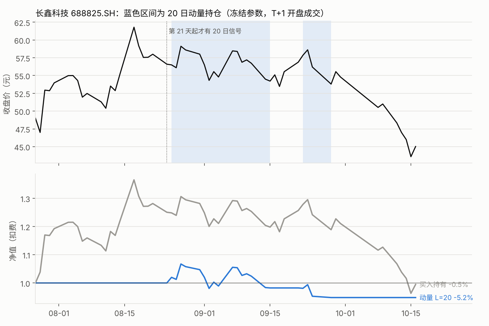
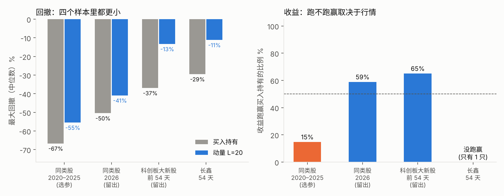
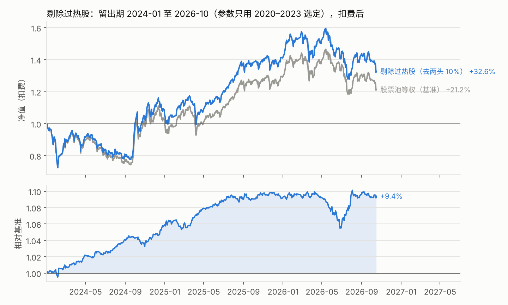

# 研究结果

口径见 [事前协议](PROTOCOL.md)，引擎见 [ENGINE.md](../docs/ENGINE.md)。所有数字由 `scripts/` 下的脚本生成，原始表在 `outputs/`。

## 1. 5DR（5 日反转）全市场

**判定：不成立。** 扣费前就跑输等权股票池，扣费后 7 个年份全部跑输。

2020-04 至 2026-10，初始资金 1 亿元，信号日收盘 → 次日开盘成交：

| 策略 | 调仓 | 费用 | 年化 | 夏普 | 最大回撤 | 相对基准年化超额 | 年化换手（倍） | 年化费用拖累 |
|---|---|---|---:|---:|---:|---:|---:|---:|
| 股票池等权（基准） | 每 5 日 | 扣费后 | 6.5% | 0.39 | −38.0% | — | 4.7 | 0.8% |
| **5DR** | 每 5 日 | 扣费前 | −2.3% | 0.05 | −52.0% | −8.3% | 85.4 | — |
| **5DR** | 每 5 日 | 扣费后 | **−11.6%** | −0.31 | −68.1% | **−17.3%** | 85.0 | 5.9% |
| 5 日动量（镜像） | 每 5 日 | 扣费后 | −23.4% | −0.88 | −84.1% | −32.0% | 82.1 | 5.7% |
| 5DR | 每日 | 扣费前 | 0.3% | 0.15 | −50.0% | −5.6% | 204.7 | — |
| 5DR | 每日 | 扣费后 | −21.1% | −0.72 | −81.3% | −27.1% | 199.5 | 14.1% |

分年超额（5DR，每 5 日调仓）：

| 年份 | 2020 | 2021 | 2022 | 2023 | 2024 | 2025 | 2026* |
|---|---:|---:|---:|---:|---:|---:|---:|
| 扣费前 | −10.4% | −3.5% | −10.5% | −4.3% | **+2.4%** | −8.1% | −23.2% |
| 扣费后 | −17.0% | −12.8% | −19.0% | −12.6% | −5.4% | −15.1% | −27.3% |

\* 2026 年截至 10-16。

### 为什么不成立：反转只发生在「涨最多」的那一头

按过去 5 日收益把股票池分十组（零费用、每 5 日调仓），年化收益是一个**倒 U 形**：中间 8 组 8.7%~13.7%，
两头都差——跌最多的一组 −2.4%，涨最多的一组 −15.5%。也就是说，这段时间里：

- **「涨多了会跌回来」很明显**：涨最多的一组每周比股票池少赚 47.6bp（t = −4.7）
- **「跌多了会涨回来」不存在**：跌最多的一组每周还少赚 13.5bp（t = −1.5），并不反弹

5DR 只买跌最多的那一组，恰好站在没有效应的那一头；它唯一的「优点」是避开了涨最多的那一组，所以比 5 日动量好。

**事后诊断**（看到结果后才做的，不参与判定）：把每周收益拆成「信号日收盘 → 次日开盘」和「次日开盘之后」，
跌最多一组的隔夜段也是负的（−3.7bp/周，t = −2.5）。所以不是「次日开盘才成交、错过了隔夜反弹」造成的——
就算能按收盘价成交，这组股票也不赚钱。

### 成本

每 5 日调仓时年换手 85 倍，一年光费用就吃掉 5.9%；每日调仓翻到 200 倍、14.1%。
对于一个扣费前每年只差几个百分点的信号，成本是决定性的：每日调仓扣费前几乎打平（0.3%），扣费后 −21%。

## 2. 长鑫科技趋势策略

规则：第 t 日收盘若过去 L 日收益 > 0，次日开盘满仓，否则空仓。

### 选参（同类股 2020–2025，34 只）

| L | 中位数「策略年化 − 买入持有年化」 | 跑赢买入持有的比例 | 中位数最大回撤（策略 / 买入持有） | 中位数交易笔数 |
|---:|---:|---:|---:|---:|
| 5 | −15.5% | 6% | −59% / −67% | 280 |
| 10 | −13.3% | 15% | −54% / −67% | 186 |
| **20** | **−9.5%** | 15% | −55% / −67% | 123 |

按协议冻结 **L = 20**。注意：三个 L 在选参样本里都**跑输**买入持有——这段时间半导体整体是大涨的，
空仓的日子错过了上涨；L = 20 只是输得最少。

### 两个留出样本

| 样本 | L = 20 收益跑赢买入持有的比例 | 中位数（策略 vs 买入持有） | 中位数最大回撤（策略 / 买入持有） |
|---|---:|---|---:|
| 同类股 2026-01 至 2026-10（34 只） | 59% | 年化 26.8% vs 19.7% | −41% / −50% |
| 科创板首日成交额前 20 大新股，上市后 54 天 | 65% | 54 天收益 −3.6% vs −9.0% | **−13% / −37%** |

### 用在长鑫上（54 个交易日，2026-07-27 至 2026-10-16）

| 规则 | 54 天收益 | 最大回撤 | 交易笔数 | 平均仓位 | 费用（元） |
|---|---:|---:|---:|---:|---:|
| 买入持有（第 2 天开盘买入） | **−0.5%** | −29.5% | 1 | 98% | 310 |
| **动量 L = 20（冻结）** | −5.2% | **−11.2%** | 4 | 33% | 2,179 |
| 动量 L = 10（仅供参考） | −4.0% | −21.0% | 12 | 43% | 7,278 |
| 动量 L = 5（仅供参考） | −23.4% | −26.9% | 10 | 41% | 4,943 |

**结论：收益没跑赢，回撤小了一大半。**

- 前 20 天没有信号（L = 20 需要 20 天历史），完全错过了上市初期从 49 元涨到 61.8 元的那一段——买入持有在 08-17 一度浮盈 +37%
- 第 21 天（08-25）趋势仍向上才买入，此时价格已在 55 元左右；之后两次进出各亏一点，09-28 之后一直空仓
- 10 月从 55 元跌到 45 元的那一段，策略完全没参与，所以最大回撤只有 −11%，而买入持有从高点回撤了 −29.5%

这和类比样本的规律一致：**趋势规则在新股上的主要作用是「躲开大跌」，不是「多赚」**。

## 3. 追加策略：剔除过热股

**判定：留出期成立**（按协议 §5 的标准），但要打折扣：想法来自看过全样本的十分位图。

**思路**：5DR 失败是因为「跌最多的」不反弹，但「涨最多的」确实会回吐。那就反过来：持有整个股票池（等权），
只把过去 5 日涨得最多、跌得最多的股票剔除掉——不去赌反弹，只是避开两头。

### 选规则（2020-04 至 2023-12，扣费后）

| 规则 | 年化 | 相对基准年化超额 | 年化换手 | 年化费用拖累 |
|---|---:|---:|---:|---:|
| 股票池等权（基准） | 5.8% | — | 2.9 倍 | 0.2% |
| A 剔除涨幅前 10% | 7.0% | +1.0% | 11.2 倍 | 0.9% |
| B 剔除涨幅前 20% | 5.9% | +0.1% | 20.1 倍 | 1.6% |
| **C 剔除涨幅前 10% 与跌幅前 10%** | **7.5%** | **+1.6%** | 18.5 倍 | 1.4% |

按协议选定 **C**。B 扣费前超额其实不小（+2.3%），但换手翻倍，费用把它吃光了——又一次说明成本是决定性的。

### 留出期（2024-01-02 至 2026-10-16，只跑一次）

| | 扣费前 | 扣费后 |
|---|---:|---:|
| 策略总收益 | +39.7% | **+32.6%** |
| 基准总收益 | +22.1% | +21.2% |
| 相对基准年化超额 | +4.9% | **+3.3%** |
| 信息比率 | 2.22 | 1.48 |
| 夏普（策略 / 基准） | 0.60 / 0.41 | 0.53 / 0.40 |
| 最大回撤（策略 / 基准） | −27.3% / −27.1% | −27.5% / −27.1% |

分年超额（扣费后）：2024 年 +5.9%、2025 年 +3.2%、2026 年（至 10-16）+0.1%，没有一年低于协议设定的 −2%。

**怎么理解这个结果**

- 它是一个「增强版的等权组合」，不是避险工具：回撤和基准几乎一样，超额来自避开两头的股票
- 超额集中在 2024–2025；2026 年 6 月一度回吐约 4%，全年基本打平。效应在变弱还是只是波动，需要更长样本
- 和 5DR 相比：同样用「过去 5 日收益」这一个信号，5DR 只买跌最多的 10%（换手 85 倍，费用拖累 5.9%），
  这里持有中间 80%（换手 18 倍，费用拖累 1.0%）。**信号没变，用法变了，结论就从「不成立」变成「成立」**

平台里的「剔除过热股」模板实现了同一规则（并列排名等细节略有差异），在留出期扣费后年化为 11.3%，研究脚本为 10.8%。
平台的基准可以选「同口径股票池等权（含费用）」，与研究脚本的基准口径一致；也可以选「股票池全部等权（零费用）」，后者不做上市天数和流动性筛选。

## 4. 结论边界

- 长鑫只有 54 天、1 只股票，任何结论都只是案例；4 笔交易谈不上统计显著
- 同类股名单是按主营业务手工整理的（见 `scripts/peers.py`），不是行业分类数据
- 2020–2025 半导体整体上涨，2026 年震荡下跌：趋势策略能否跑赢买入持有，主要取决于样本期是牛是熊
- 未建模冲击成本；1 亿元做 5DR 时每只约 30 万元，对小盘股可能低估成本
- 剔除过热股的想法来自全样本十分位结果，留出期并非完全没被看过
